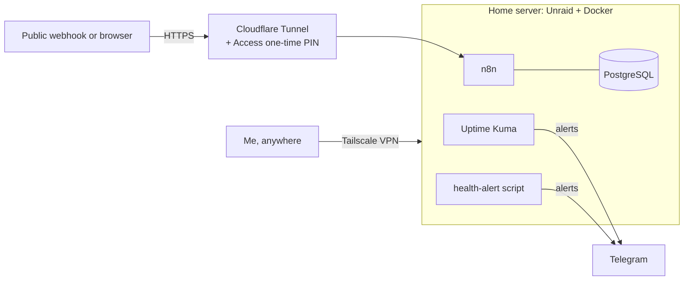

# Homelab

An old laptop turned into a 24/7 home server that runs my automations and AI agents, reachable from anywhere **without opening a single port** on the router.



## Hardware

A 2015 laptop: Intel Core i5-5200U, 8 GB RAM, 1 TB HDD. Lid closed, running all the time.

## What runs on it

| Service | Purpose |
|---|---|
| **Unraid** | Server OS with a web UI, manages the disk and Docker |
| **n8n + PostgreSQL** | Workflow automation for my personal and client agents |
| **Cloudflare Tunnel** | Publishes only n8n to the internet, behind Cloudflare Access (one-time PIN login) |
| **Tailscale** | Private VPN for SSH and admin pages; the router has no open ports |
| **Uptime Kuma** | Checks n8n, the Unraid UI and SSH every 60 s and alerts on Telegram |
| **health-alert** | Bash script every 5 min: CPU temperature and load, alerts only after 2 readings in a row |

## Security choices

- No port forwarding. Admin access goes through Tailscale only.
- PostgreSQL sits on an internal Docker network; only n8n can reach it.
- The tunnel container runs as a non-root user with a read-only filesystem and all Linux capabilities dropped.
- CPU and memory limits on every container, so one runaway workflow cannot take the server down.
- Secrets live in `.env` files and mounted files on the server, never in this repository.

## Repository layout

```
compose/n8n/            n8n + PostgreSQL (compose.yaml, .env.example)
compose/cloudflared/    Cloudflare Tunnel connector (compose.yaml, config.example.yml, .env.example)
health-alert/           CPU temperature and load alert script for Unraid
```

## Run

```bash
cp compose/n8n/.env.example compose/n8n/.env          # fill in real values
docker network create cloudflare-edge
docker compose -f compose/n8n/compose.yaml --env-file compose/n8n/.env up -d
docker compose -f compose/cloudflared/compose.yaml --env-file compose/cloudflared/.env up -d
```

## Next

- Off-site backups with a tested restore.
- A remote job runner so Claude Code and Codex can take tasks on the server over Tailscale.
